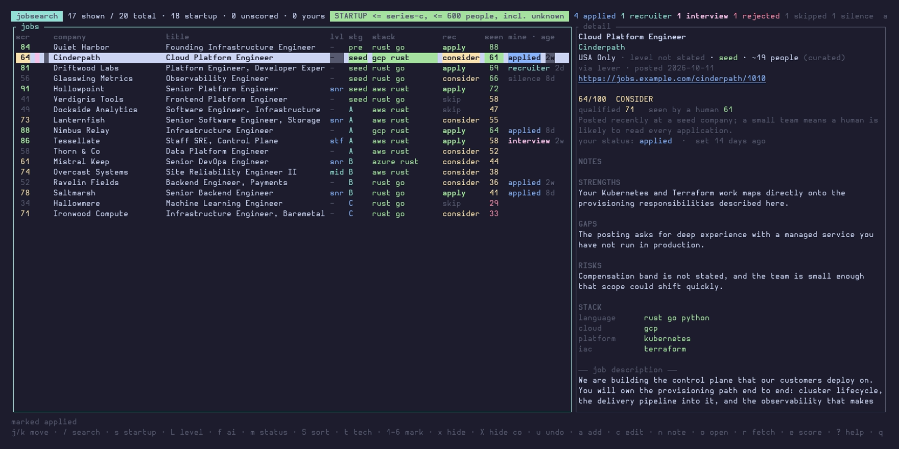

<h1 align="center">jobsearch</h1>

<p align="center">
  <strong>A startup-focused job search and application tracker that lives in your terminal.</strong><br>
  Pulls roles straight from Greenhouse, Ashby, Lever, Workable and SmartRecruiters,<br>
  filters them against rules you own, scores the fit, and gives you one<br>
  keyboard-driven board to work from.
</p>

<p align="center">
  <a href="https://github.com/aethyriion/jobsearch/actions/workflows/ci.yml"></a>
  <a href="LICENSE"></a>
  
  
</p>

<p align="center">
  
</p>

## Why this exists

Job boards show you everything and remember nothing. You search the same
terms every morning, re-read the same postings, and lose track of which of
the forty things you applied to ever answered.

This inverts that. It fetches once, remembers forever, and makes the board
a thing you *triage* rather than a thing you *search*. Four ideas do most
of the work:

**It knows what stage each company is at.** Startup mode ships on and is
one keypress from off. Crucially it's a **view, not a fetch setting** —
everything fetched is always stored, so widening the cutoff is instant and
never needs a re-fetch. Change your mind at 11pm and the whole history
re-filters in milliseconds.

**It scores two different questions.** "Do I clear the bar this posting
sets?" and "will a human ever see my application?" fail in opposite
directions, and one number can't tell you which kind of bad news you're
looking at. They're separate axes, and the split is what makes a low score
actionable — see [Two scores, not one](#two-scores-not-one).

**It tracks what happens next.** Every status change is timestamped, so
the board tells you an interview has been silent for three weeks and it's
time to chase or let go. No spreadsheet.

**Nothing leaves your machine.** Requests go to the job sources you
configure and, for the optional AI step, to the Anthropic API. Postings,
scores and your private notes live in one local SQLite file you can query
with `sqlite3`.

<p align="center">
  
</p>

> The demo above runs on fictional companies. Your real board is whatever
> `companies.yaml` and `aggregators.yaml` point at.

## Contents

[Why this exists](#why-this-exists) · [Quick start](#quick-start) · [How it works](#how-it-works) · [Startup mode](#startup-mode) · [Two scores](#two-scores-not-one) · [Tech stack](#tech-stack) · [What's stored](#whats-stored) · [Development](#development)

Every command, key and config option lives in **[the reference guide](docs/guide.md)**.

## Quick start

### Install

```bash
cargo install jobsearch                      # any platform with Rust
brew install aethyriion/tap/jobsearch        # macOS and Linux
scoop bucket add aethyriion https://github.com/aethyriion/scoop-bucket
scoop install jobsearch                      # Windows
```

Or grab a prebuilt binary from [the latest
release](https://github.com/aethyriion/jobsearch/releases/latest) and put it
on your `PATH`. Building from source needs **Rust 1.88 or newer** and nothing
else — SQLite is compiled in and TLS is rustls, so there's no system OpenSSL:

```bash
git clone https://github.com/aethyriion/jobsearch.git
cd jobsearch && cargo build --release
```

### Set up

```bash
jobsearch init     # writes the default config to your config directory
```

`init` tells you where it put things. Config goes to `~/.config/jobsearch`
(`~/Library/Application Support/jobsearch` on macOS, `%APPDATA%\jobsearch` on
Windows) and the database to the matching data directory. Re-running it never
overwrites a file you've edited unless you pass `--force`.

Working from a git checkout instead? A directory containing `filters.yaml` is
used as-is, so the repo keeps working with no setup and its `data/` stays
local to it.

**Now edit `filters.yaml` before your first fetch.** As shipped,
`location_allow_patterns` accepts US and US-inclusive remote roles and
nothing else. If you're searching anywhere else, or you want on-site roles
near you, that list is the one thing you must change — leaving it alone is
by far the most common reason a first run returns nothing. The file's
header tells you what to edit; [the configuration reference](docs/guide.md#configuration) has the
detail.

### Run

```bash
jobsearch check          # validate every config file, and show where they live
jobsearch discover-yc    # learn company stages (free) — see below
jobsearch fetch          # pull jobs (free)
jobsearch                # open the TUI
```

`discover-yc` is in that list deliberately: **startup mode is on by
default, and a fresh install knows no company stages at all**, so without it
the headline feature has nothing to filter on — the shipped `companies.yaml`
has a stage for only 16 of its entries. It needs no credentials.

Scoring with Claude is a separate, optional step — `jobsearch evaluate` —
and it is the only thing here that costs money. Everything above is free.

### Where things live

| | |
|---|---|
| `--root DIR` | wins over everything |
| `JOBSEARCH_ROOT` | same, via the environment |
| the working directory | used when it contains a `filters.yaml` |
| your config directory | the default, and where `init` writes |

`JOBSEARCH_DB_PATH` overrides the database location on its own.

## How it works

1. **Fetch** — open roles come from four kinds of source:

   | Source | Configured in | What it gives you |
   |---|---|---|
   | Company ATS boards | `companies.yaml` | Greenhouse, Ashby, Workable, Lever, SmartRecruiters. Precise, low noise, the whole board. |
   | Aggregators | `aggregators.yaml` | Adzuna, Remotive — broad keyword+location search across employers you haven't identified yet. Wider reach, much more noise. |
   | Hacker News | `aggregators.yaml` | The monthly "Who is hiring?" thread. Startup-dense by nature: almost every post is a small company hiring directly. |
   | Y Combinator | `jobsearch discover-yc` | ~1,500 YC companies currently hiring, each with a stage and a headcount. |

   Company boards are fetched concurrently (8 at a time by default), so a
   run over the whole of companies.yaml takes seconds rather than minutes.

2. **Filter** (`filters.yaml`) — drops anything that isn't an
   engineering-shaped title, isn't in an allowed location, or whose JD
   requires a stack you've excluded.

3. **Dedup** — everything fetched goes into the SQLite database,
   keyed both by URL and by normalized company+title+location, so re-runs
   only ever surface genuinely new postings. Jobs that *fail* the filters
   are stored too, which is what makes `jobsearch refilter` possible.

4. **Score** (optional, costs money) — sends each filtered candidate plus
   your `profile.yaml` to Claude, which returns a 0-100 fit score,
   concrete gaps, transferable strengths, risk factors, an
   apply/consider/skip recommendation — and a guess at the company's
   stage.

5. **Triage** — the TUI. Mark each job `applied / interview / rejected /
   skipped / silence`, attach notes, open the posting in a browser.

## Startup mode

The point of the tool. A company sits somewhere on this axis:

```
pre-seed · seed · series-a · series-b · series-c · growth · public · big-tech
└──────────────── startup, by default ────────────────┘
```

Where the cutoff sits is `startup:` in `filters.yaml`. Press `s` in the
TUI to toggle it, or run `jobsearch evaluate --all-stages` to widen it for
one scoring run.

**Stage comes from three sources**, and a weaker one never overwrites a
stronger one:

| Source | How it's set | Trust |
|---|---|---|
| `curated` | A `stage:` field on a `companies.yaml` entry, written by hand. | Highest — a human looked it up. |
| `source` | The YC directory, via `jobsearch discover-yc`. Stage is derived from YC's Early/Growth label refined by team size, with `status: Public` overriding both. | High — real data, coarse mapping. |
| `ai` | Inferred by the scoring step from the JD: funding mentioned, team size, "founding engineer" in the title, equity in the comp. Discarded below 50% confidence. | Lowest — covers the long tail nothing else reaches. |

The TUI shows the provenance next to the stage (`series-b (curated)` vs.
`seed (ai)`) so you know how much to trust it.

Stage is stored per *company*, not per job, keyed by a normalized name. A
stage learned once applies to every posting from that employer — including
ones fetched months later from a completely different source.

### Getting stage coverage

A fresh checkout knows nothing about stage, so start here:

```bash
jobsearch discover-yc
```

That records stage and headcount for every YC company currently hiring
(~1,500 of them), then probes each US-reachable one for a Greenhouse,
Ashby or Lever board and appends the ones it finds to `companies.yaml`
with their stage filled in. Expect roughly a 50% board-resolution rate and
a few minutes of runtime; results are cached, so a re-run only probes
companies it hasn't seen. Use `--limit 40` first to see the hit rate
before committing to a full pass.

Then, as coverage grows, tighten `include_unknown`:

```yaml
startup:
  include_unknown: true   # start here — unknown-stage jobs stay visible
  # include_unknown: false  # switch once `jobsearch check` shows good coverage
```

With `false`, "startup" means *known to be a startup* rather than *not
known to be big*. With `true` on a fresh database, everything shows, which
is the right failure mode — an empty startup view would look like a broken
filter rather than like missing data.

## Two scores, not one

The AI step answers two questions separately, because they fail in opposite
directions and a single number can't say which one you're looking at:

- **`qualified`** — do you clear the bar *this posting sets*? Judged only
  against what the posting states. Being more experienced than it asks for
  never lowers this, and an unfamiliar product domain doesn't either unless
  the posting requires domain experience.
- **`seen`** — the estimated chance a human or an ATS screen actually
  surfaces your application. 50 is average.

`match_score` combines them (roughly 70/30), so sorting by score still means
"worth applying to". But the detail pane shows both, plus the specific
reasons behind the odds:

```
72/100  APPLY
qualified 82   seen by a human 42
Posted 2 days ago at a well-known public fintech (high application volume
for remote US roles), but the posting explicitly requires Python or Kotlin
proficiency, which will screen out some of the general applicant pool.
```

The split is what makes a low score actionable. `qualified 30 / seen 70` means
don't bother. `qualified 90 / seen 20` means you'd walk the interview but the
application will drown — find a referral, or apply anyway knowing the odds.
Those are different decisions, and one blended number hides which you have.

`S` sorts by `odds` and by `qualified` as well as by `score`.

### What lowers the odds

Judged from the posting and its metadata — posting age and agency-vs-direct
are passed in explicitly, since neither appears in the JD text:

| Lowers | Raises |
|---|---|
| A large or well-known employer with a fully-remote req | A small company where a founder reads every application |
| A posting more than ~45 days old | A niche stack that shrinks the pool (Rust, Nix) |
| ATS knockouts you miss — required degree, cert, clearance | A narrow geography |
| A staffing-agency listing with no real req behind it | An unusual skill combination you genuinely have |
| Being visibly over-leveled for the band | A posting describing a specific problem, not a generic req |

Over-qualification lives here rather than in `qualified`, which is the point:
being a ten-year engineer applying to a role asking for four is not a gap, but
it *is* something a recruiter screens on.

### After changing the prompt or profile

Stored verdicts were reached under whatever rubric was in force at the time.
`jobsearch evaluate --rescore` re-runs everything; it prints how many already
have a score before spending anything, and `--dry-run` shows the queue first.

## Tech stack

Every posting is tagged with the technologies its description mentions —
deterministically, from `tech.yaml`'s regex patterns. No model, no cost,
no network. `t` opens a picker of the tags actually present in your data,
with counts:

```
┌ technology ──────────────────────────────┐
│ > language:go              316           │
│   language:python          315           │
│   cloud:aws                281           │
│   platform:kubernetes      270           │
│   cloud:gcp                183           │
│   language:rust             79           │
└──────────────────────────────────────────┘
```

The counts are the feature — "aws 281 / gcp 183" answers the question
before you select anything. `jobsearch tech` prints the whole breakdown
as a histogram; `jobsearch tech --tag rust` lists the matching postings.

Tags are **derived, never stored**: recomputed from the stored description
on every read, so improving a pattern takes effect on the next run with no
migration and no re-fetch. `T` clears the filter.

### Writing patterns

`tech.yaml` groups tags by category. Three mechanisms exist because job
descriptions are full of words that look like technologies and aren't —
each of the following was a real false positive found in live data:

| | |
|---|---|
| `case_sensitive: true` | `\bgo\b` matches "go to market"; `\bGo\b` matches the language. The same trick makes `R` usable. |
| `exclude:` | Vetoes the tag for the whole posting. "Spark Capital" is a VC in one company's boilerplate and was counted as Apache Spark on every posting they publish. |
| Just being specific | A bare `\bworkers\b` matched *"unincorporated Los Angeles County workers"* far more often than Cloudflare Workers. `\bts\b` matched *"TS/SCI"* security clearances. |

Two regex traps worth knowing, both of which have bitten this repo:

- **Never put a trailing `\b` after punctuation.** `\bc\+\+\b` can never
  match, because `+` isn't a word character. Same for `C#`. (This is the
  same bug that made two of `filters.yaml`'s dealbreakers silently inert.)
- **Every pattern compiles with `(?-u)`.** Unicode-aware `\b` and case
  folding cost 1.21s across the corpus; the ASCII equivalents cost 43ms
  for byte-identical results. That 28× is what makes tagging-on-every-read
  affordable instead of needing a cache.

## What's stored

One SQLite file — `seen_jobs.sqlite3`, in your data directory, or under
`data/` when you run from a checkout:

| Table | Holds |
|---|---|
| `seen_jobs` | Dedup keys. Every job ever fetched, pass or fail. |
| `job_details` | The full record including JD text, keyed by URL. |
| `ai_evaluations` | Scores and reasoning. |
| `user_status` | Your `my_status` and notes. |
| `status_history` | Append-only log of every status transition, which is where the age column and `jobsearch stale` get their numbers. A log rather than `applied_at`/`recruiter_at` columns because statuses are a vocabulary that grows — `recruiter` was added after the fact, and each new one would otherwise mean a migration. |
| `company_stage` | Stage, headcount and provenance per company. |
| `job_channel` | Hand-set agency/direct overrides. Only overrides — the guess is derived on read. |
| `dismissed_jobs` / `dismissed_companies` | What you've hidden. Separate from the job rows, so hiding destroys nothing and restoring is lossless. |
| `ats_resolution` | Which ATS board a company resolved to — including the misses, so re-runs don't re-probe. |

Hand-entered rows live in those same tables with `job_details.source =
'manual'` — no separate table, so every query and export includes them
without special-casing.

JD text deliberately stays out of the CSVs: a multi-KB job description in
a spreadsheet cell defeats the point of the CSV being a quick scannable
list. `candidates.csv` and `scored_candidates.csv`, written beside the
database, are exports,
not the source of truth.

## A note on Wellfound

Wellfound (formerly AngelList Talent) is the obvious missing
startup-native source, and its absence is deliberate. Its GraphQL endpoint
returns 403 behind a Cloudflare interstitial for any client that doesn't
present as a full browser — and so does `robots.txt`. Reading it would
mean impersonating a browser specifically to defeat bot protection the
site is clearly choosing to apply, so this tool doesn't. The YC directory
and the HN thread cover the same ground through interfaces meant to be
read by programs. If you want Wellfound coverage, their email job alerts
into a mailbox you read yourself is the supported path.

## Development

```bash
cargo test          # unit tests, no network
cargo clippy --all-targets -- -D warnings
cargo fmt
```

Tests cover the filter rules (including the regex trap above), dedup and
stage-precedence in the store, the HN posting parser, YC's stage mapping,
the Anthropic tool-response parser (complete, truncated and refused
shapes), `companies.yaml` appending, the manual-entry form's modal keys and merge
semantics, the seniority title reader and its policy, dismissal
persistence across refilter and scoring, the tech detector's
false-positive guards, and the TUI's filter/sort/selection logic. None of them touch
the network.

### Regenerating the demo GIF

The README's GIF and screenshot are generated, not hand-captured, so they
can't drift from the real UI:

```bash
./docs/demo-data.sh      # builds a throwaway DB of fictional companies
vhs docs/demo.tape       # records docs/demo.gif + docs/screenshot.png
```

`docs/demo.tape` is a [VHS](https://github.com/charmbracelet/vhs) script of
literal keystrokes, so the recording is deterministic and anyone can
reproduce it. Re-run both after changing the TUI's layout or keymap — a
stale GIF is worse than no GIF. The demo database is fictional by design:
a fabricated score next to a real employer's name would read as a real
assessment of that company.

### Layout

```
src/
  main.rs         CLI
  config.rs       YAML loaders
  model.rs        Job, Stage, Evaluation, JobRow
  filters.rs      filters.yaml rules + the startup policy
  store.rs        SQLite
  tech.rs         deterministic tech-stack detection (tech.yaml)
  pipeline.rs     fetch -> filter -> dedup -> store, and the scoring pass
  evaluate.rs     Anthropic Messages API (raw HTTP; there's no official Rust SDK)
  discover.rs     appending to companies.yaml without eating its comments
  sources/
    ats.rs          Greenhouse, Ashby, Workable, Lever, SmartRecruiters
    aggregators.rs  Adzuna, Remotive
    hn.rs           Hacker News "Who is hiring"
    yc.rs           Y Combinator directory
    http.rs         shared client
  tui/
    app.rs        state and transitions (no terminal I/O — unit-testable)
    form.rs       the manual-entry page's fields and validation
    ui.rs         rendering
    mod.rs        event loop and background tasks
```

## Notes on scope

- Greenhouse, Ashby, Workable and Lever were each validated against live
  responses. SmartRecruiters is built from documentation and third-party
  corroboration only — verify a new SmartRecruiters company with
  `jobsearch fetch --company <slug>` before trusting it.
- No Workday support. Its job-search API is POST-based with a different
  pagination shape, and a lot of large non-tech employers sit behind it —
  an Adzuna query scoped to your area is the practical way to cover them.
- A failing company board logs a warning and the run continues; every
  other board in `companies.yaml` is still worth having.

## Credits

Derived from [**job_search_tool**](https://github.com/fedorchenko-juli/job_search_tool)
by Yuliia Fedorchenko, MIT licensed.

That project is where this one starts: the Python fetch → filter → dedup →
score pipeline, the SQLite schema, the `filters.yaml` / `companies.yaml` /
`aggregators.yaml` config design, and the AI evaluation's field vocabulary
(`genuine_gaps`, `transferable_strengths`, `risk_factors`) are all hers.
This repository ports that pipeline to Rust and builds a terminal UI on top
of it, adding startup-stage filtering, a seniority axis, reversible
dismissal, deterministic tech-stack detection, agency-vs-direct detection,
two-axis scoring (qualification separated from callback odds), and
timestamped status history. `profile.example.yaml` and `profile.sample.yaml`
are substantially her work, with only their references to the old Python
module names updated.

If you want the original Python pipeline or its Next.js review board, go to
the upstream repository — both are still there, and the full upstream
history is preserved in this repository's git log.

## License

[MIT](LICENSE) — see the file for both copyright holders.
